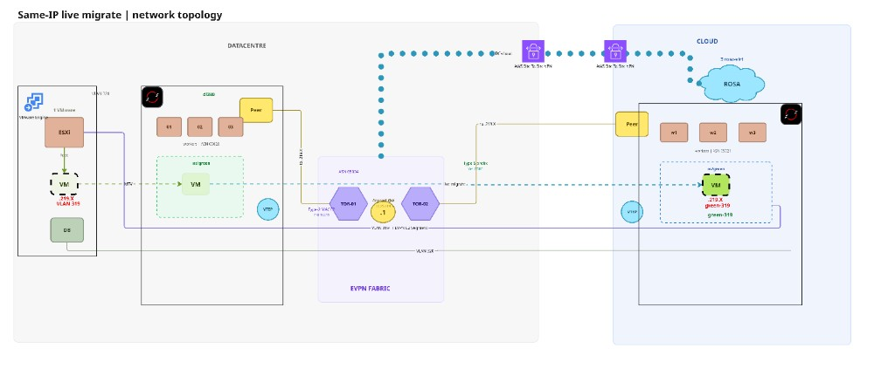

# Cross-cluster EVPN and VM migration (dl380 ↔ rosa-virt)

Lab knowledge pack: annotated **rendered** objects and notes from connecting
an on-prem OpenShift Virtualization cluster to ROSA over EVPN, and migrating
VMs between them.

We used **ACM** in the lab to install and to render/apply the
networking objects and supporting infra. This repo keeps the resulting YAMLs (not PolicyGenerator
or policy wrappers) so the applied shape is easy to read.

Start here for the story; use site folders for YAML.

## Evolution (short)

1. **Route reflector era** — outbound-only BGP to a Containerlab FRR RR so
   both sites could exchange EVPN without inbound :179 on FRR-k8s.
2. **Fabric era (current)** — peer lab TOR RRs and align CUDN VNIs/RTs with
   fabric segments (green-319 / blue-320) so clusters participate in those L2s.

Full timeline: [docs/evolution.md](docs/evolution.md).  
RR vs fabric (VLAN exposure, migration impact): [docs/peering-models.md](docs/peering-models.md).

## Current architecture (fabric path)

```
dl380 (on-prem)                          rosa-virt (ROSA)
CUDNs e.g. green-319 / blue-320          CUDNs green-319 / blue-320
FRR ↔ fabric TOR Lo0 (ASN 65004)         FRR ASN 65021 ↔ same TOR Lo0s
VTEP: node loopbacks / lab CIDR          VTEP: VPC/machine CIDR 10.10.0.0/17
        \                                  /
         \---- site connectivity (VPN) ---/
Guest L2: EVPN macVRF when RTs match
Migration protocol: pod-network path (Submariner workaround today)
Hub: MTV forklift drives plans via both APIs
```

Historical RR diagram and apply notes: `route-reflector-example/` + [docs/evolution.md](docs/evolution.md).



*Same-IP live migrate on fabric-aligned CUDNs (e.g. green-319); Submariner/workaround detail: [docs/migration.md](docs/migration.md).*

## Workarounds (temporary)

| Workaround | Why we needed it | Hoped successor |
|------------|------------------|-----------------|
| Submariner between clusters | Live-mig listener is a foreign **pod** IP | MTV / Virt supported cross-cluster path |
| Cold land on default network, then move to CUDN | Cold path assumes default UDN | MTV + Network/CUDN-aware plans |
| Containerlab RR | No inbound BGP on FRR-k8s | Inbound :179 or supported RR story (RFE-4) |

Details: [docs/migration.md](docs/migration.md).

## Directory layout

```
├── rosa-cluster/              # Current rendered objects — rosa-virt EVPN (+ related)
├── on-prem/                   # dl380 examples (EVPN, DNS hacks, virt notes)
├── hub/                       # Hub MTV / Submariner rendered examples
├── route-reflector-example/   # Phase 1 RR lab (historical)
├── docs/                      # Evolution, peering, migration, component inventory
└── NOTES.md                   # Troubleshooting appendix
```

## Prerequisites (lab)

| Component | Notes |
|-----------|--------|
| OpenShift / ROSA | 4.22+ OVN-Kubernetes |
| OpenShift Virtualization | KubeVirt `l2bridge`, decentralized live migration where used |
| MTV on hub | Forklift plans across both clusters |
| FRR-k8s | Route advertisements / EVPN underlay peering |
| Site connectivity | Routable VTEP CIDRs; Submariner (today) for pod CIDRs |
| Containerlab | Only if reproducing Phase 1 RR |

## Where to apply / inspect

| Site | Folder |
|------|--------|
| rosa-virt | [rosa-cluster/README.md](rosa-cluster/README.md) |
| dl380 | [on-prem/README.md](on-prem/README.md) |
| Hub | [hub/README.md](hub/README.md) |

## Known limitations

- IPAM collisions if both clusters auto-assign from the same subnet without `reservedSubnets` / static IPs
- VTEP CIDRs must be bidirectionally reachable
- Fabric peering ≠ full fabric leaf (see RFEs under `docs/superpowers/specs/`)
- Submariner MTU can stall migration sync — see `NOTES.md`

## License

Apache-2.0
