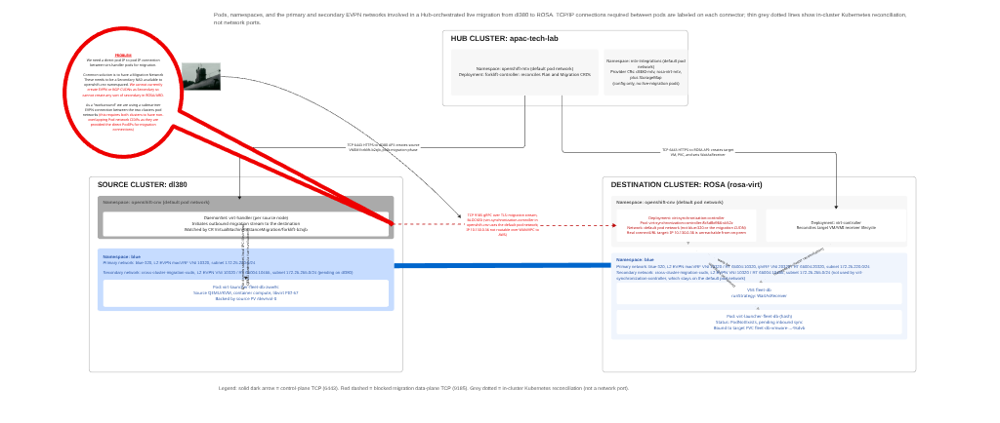
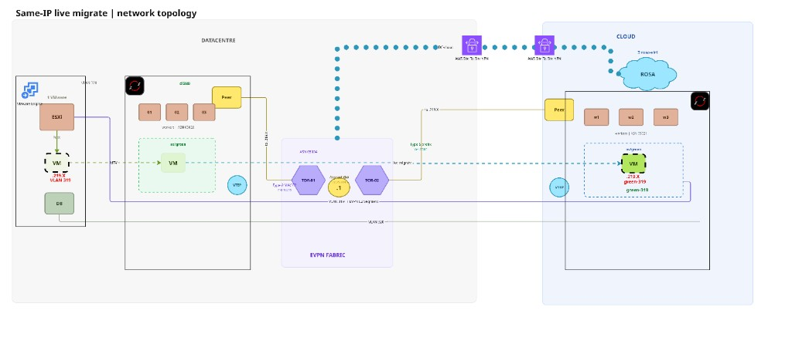

# Cross-cluster VM migration notes

## Why Submariner (workaround)

Decentralized live migration requires the source `virt-handler` to dial the
destination migration listener (commonly advertised as a **pod** IP on a
high port such as `:9185`). That address lives on the destination cluster’s
OVN pod overlay. Site-to-site VPN/VPC routing typically reaches node/VPC
CIDRs, **not** foreign pod CIDRs — so the sync fails with timeouts /
`DecentralizedNotLiveMigratable`.

**What Submariner gives us:** L3 connectivity between cluster networks so
that migration (and related importer) paths can reach pod endpoints across
sites, with the usual MTU caveats on the tunnel.

**What Submariner is not:** A long-term product architecture for MTV or for
CUDN/EVPN. It is a **connectivity workaround** until:

1. **MTV / Virtualization** can drive cross-cluster live migration over a
   supported, routable control/data path (for example node-scoped listeners,
   explicit migration networks, or hub-brokered transfer that does not assume
   raw foreign pod CIDR reachability), and/or
2. **Network / CUDN** can provide a first-class, migration-safe network path
   (including clear rules for Primary CUDN vs default network during transfer)
   so operators are not forced to bolt on a mesh.

When those land, expect to **remove or shrink** Submariner from this story.

**Lab note:** We installed and configured Submariner via ACM; example **rendered**
Broker / SubmarinerConfig-style objects belong under `hub/` (not policy wrappers).

Cold / warm disk transfer also needs destination importer pods to reach
source API (`6443`) and export (`443`). Treat underlay + any mesh MTU as
part of the same reachability design. Detail and failure traces: root
`NOTES.md`.

*Figure: Live migration needs a routable path to the destination listener (pod overlay). Submariner provides that workaround; guest EVPN/CUDN L2 does not replace it.*

## Why cold migration fails for VMs already on a CUDN

Cold migration’s importer/export path assumes the VM’s namespace uses the
**default** pod network for transfer plumbing. A VM whose Primary UDN/CUDN
*is* the guest network breaks that assumption: the workload (and often the
namespace) is isolated onto the CUDN, so the usual cold-migration networking
does not line up.

**Workaround used in practice:**

1. Cold-migrate into a temporary namespace on the **default** network
   (“bridge” / landing namespace).
2. Locally move/recreate onto the target CUDN namespace once disks are present.

**Future:** Prefer an MTV-supported landing workflow and/or Network guidance
that makes CUDN-primary VMs first-class for cold/warm/live plans — so this
two-step dance is unnecessary.

## Live migration and EVPN

Guest L2 for live migration in this lab uses KubeVirt `l2bridge` with
`migration: {}` on the Primary EVPN CUDN (shared macVRF across sites when
fabric Phase 2 is up). That is **guest** traffic. It does **not** replace
the Submariner (or successor) path for the migration protocol itself.

*Figure: Same-IP live migrate — guest stays on the fabric-aligned L2/CUDN while migration control/data still needs the Submariner (or successor) path.*

## Hub role (rendered)

The hub runs MTV (`forklift-controller`), which talks to both cluster APIs
(`6443`) to create plans, VMIMs, and target VM/PVC objects. Example hub
objects belong under `hub/` — see that README.
